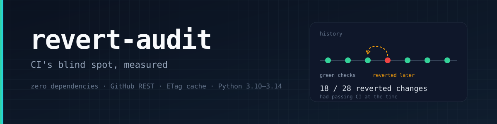
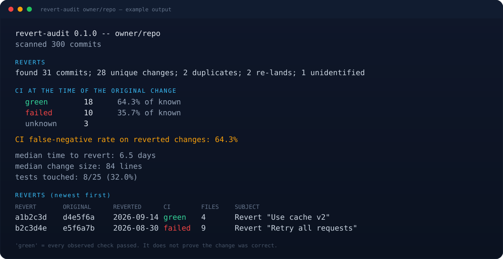

<p align="center">
  
</p>

<p align="center">
  <a href="https://github.com/muguang1224/revert-audit/actions/workflows/ci.yml"></a>
  
  
  <a href="LICENSE"></a>
</p>

**CI is a filter, not a proof.** `revert-audit` measures the filter's blind spot: of the changes a repository later had to revert, how many had passed every observed check at the time?

It walks the commit history, resolves each revert back to the change it undid, and looks up the CI that ran on that change. The headline number is a **CI false-negative rate on reverted changes** — not a bug rate, and not a judgment about the people who merged them.

<p align="center">
  
</p>

## Quick start

```bash
git clone https://github.com/muguang1224/revert-audit
cd revert-audit

# unauthenticated works for small samples (60 requests/hour)
python3 revert_audit.py owner/repo --limit 100 --max-reverts 5

# recommended: a token raises the limit to 5,000 requests/hour
GITHUB_TOKEN=... python3 revert_audit.py owner/repo --limit 500 --max-reverts 50
```

The tool only reads public GitHub data (private repositories work if the token can see them). It never writes to the audited repository.

## What it reports

```text
revert-audit 0.1.0 -- owner/repo
scanned 300 commits

REVERTS
  found 31 commits; 28 unique changes; 2 duplicates; 2 re-lands; 1 unidentified

CI AT THE TIME OF THE ORIGINAL CHANGE
  green      18   64.3% of known
  failed     10   35.7% of known
  unknown     3

  CI false-negative rate on reverted changes: 64.3%

  median time to revert: 6.5 days
  median change size:    84 lines
  tests touched:         8/25 (32.0%)
```

The table lists each revert with the original commit, the revert date, the CI verdict, and the number of files. `--json` contains everything, including check names and failure names.

## How the verdict is computed

1. **Find reverts.** Commit subjects starting with `Revert "..."`, bodies with `This reverts commit <sha>`, and `Reverts #N` references. Reverts of reverts (re-lands) are counted separately and excluded from the rate. A revert with no resolvable original is reported as `unidentified`, not silently dropped.
2. **Resolve the original.** Prefer the SHA in the message; otherwise the referenced pull request. The PR's head commit is the CI source of truth, with the merge commit as a fallback.
3. **Read CI.** Combine check runs (`/check-runs`) and legacy commit statuses (`/status`). Any failure means `failed`; all passing means `green`; missing, pending, or unavailable checks mean `unknown`. "Unknown" is a real outcome, not a zero.

The rate is `green / (green + failed)`. Unknowns are excluded from the denominator and reported separately.

## Boundaries

- **Reverted is not the same as buggy.** Reverts happen for product, performance, policy, and dependency reasons. The tool measures CI coverage of changes that were undone; it does not claim they were defective.
- **Only observed checks count.** Old commits often have expired checks; those are `unknown`. Required-check policy is not queried (that needs admin access), so this is all checks, not only branch-protection checks.
- **One message can reference several commits.** GitHub's `git revert` of a merge can list multiple `This reverts commit` lines; the first is used.
- **Squash-merged revert PRs can be opaque.** If the revert PR body is discarded by the squash, only the title remains; such a revert is `unidentified`.
- **Merge commits can omit file lists.** GitHub returns no `files` for very large merges; the PR's `changed_files`/`additions`/`deletions` are used instead when available.
- **GitHub only.** The API surface is GitHub REST; GitLab/Bitbucket are not supported.
- **Static and read-only.** No repository files are edited; no CI is triggered.

## Caching and offline runs

Every response is cached under `.revert-audit-cache/` keyed by URL, with ETag revalidation.

```bash
python3 revert_audit.py owner/repo --limit 500          # fills the cache
python3 revert_audit.py owner/repo --offline --json     # re-render from cache
python3 revert_audit.py owner/repo --refresh            # ignore ETags
```

`--offline` never touches the network. If a needed object is not cached, the affected revert becomes `unidentified` with a warning — it is not guessed.

## CLI

```text
revert-audit REPO [--token T] [--limit N] [--max-reverts N] [--since DATE]
               [--json] [--show N] [--fail-on-green-rate RATE]
               [--cache-dir DIR | --no-cache] [--offline] [--refresh]
```

Exit codes: `0` report produced, `1` `--fail-on-green-rate` threshold met, `2` tool/API error.

`--fail-on-green-rate 0.7` turns the metric into a gate: fail when at least 70% of known reverted changes had green CI.

## Tests

```bash
python3 -m unittest discover -s tests -v
```

90 tests cover message parsing, PR/commit resolution, CI classification, summary math, ETag/offline cache behavior, pagination (including repeated pages), CLI exit codes, and JSON stability. No test needs the network.

## Layout

```
revert_audit.py          single-file CLI
tests/                   unittest suite with fake client/transport
.github/workflows/ci.yml Python 3.10-3.14 matrix
assets/                  banner and example output
SKILL.md                 agent skill wrapper
```

## 中文简介

`revert-audit` 量化一个很少被公开讨论的指标：**被回滚的改动里，有多少当时 CI 是全绿的**。它扫描 GitHub 仓库历史，识别 revert 提交，回溯被撤销的原始改动，再查原始改动上的 check runs / commit statuses。结果分为 green / failed / unknown 三档，unknown 不进分母；re-land（对 revert 的 revert）单独计数。零依赖、只读、支持 ETag 缓存与离线重放。它衡量的口径是“被回滚”，不是“有 bug”；回滚可能是产品决策，报告里不会把两者混为一谈。

## License

MIT
